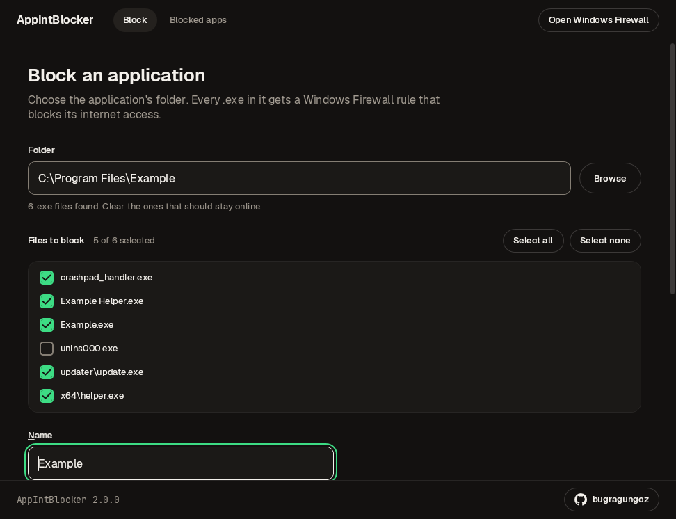
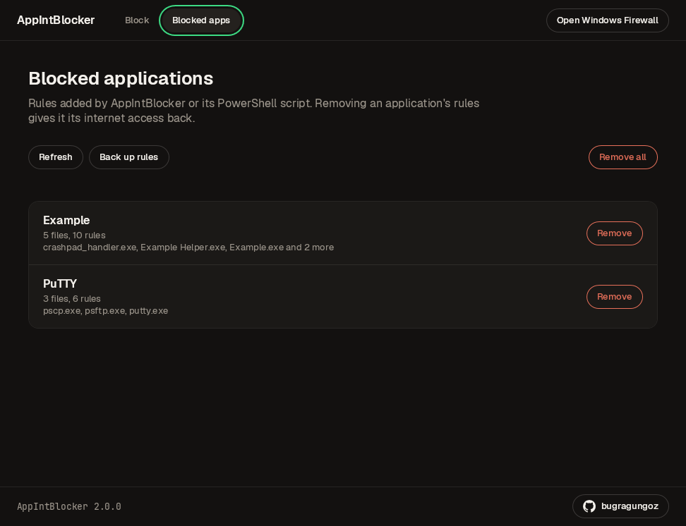

# AppIntBlockerGUI

> **Not fully tested yet.** Version 2.0.0 builds and its tests pass on Windows, but it has not yet
> been run against a real Windows Firewall. Try it in Windows Sandbox or a virtual machine first.

A small Windows app that blocks an application's internet access. Choose the application's folder,
check the `.exe` files found in it, and choose Block: each file gets a Windows Firewall rule that
blocks it, inbound and outbound. It is the window version of
[AppIntBlocker](https://github.com/bugragungoz/AppIntBlocker), the PowerShell script, and the two
share their rules.



## Download

You need Windows 10 or 11, an administrator account and the
[.NET 8 Desktop Runtime](https://dotnet.microsoft.com/download/dotnet/8.0). If the runtime is
missing, the app says so when it starts and links to the download.

1. Download `AppIntBlockerGUI-<version>-win-x64.zip` from
   [Releases](https://github.com/bugragungoz/AppIntBlockerGUI/releases) and unzip it.
2. Run `AppIntBlockerGUI.exe` and allow the administrator prompt: changing firewall rules needs it.

Every build on the [Actions](https://github.com/bugragungoz/AppIntBlockerGUI/actions) page also
has the app attached as an artifact.

## Use

**Block**

1. Choose **Browse** and pick the application's folder, or paste its path. A path copied with
   Explorer's "Copy as path" works as it is.
2. Clear the files that should keep their internet access. The name is filled in from the folder;
   change it if you like.
3. Leave **Back up the firewall rules first** on and choose **Block**.

**Blocked apps** lists every application with rules from this app or the script. **Remove** gives
one application its internet access back, **Remove all** does it for every one, and
**Back up rules** saves a copy of the whole firewall.



Backups are saved in `Documents\AppIntBlocker\Backups`. To restore one, run this in PowerShell as
administrator, with the path of your backup file. It replaces all current firewall rules with the
backed-up ones, including rules other programs added since:

```powershell
netsh advfirewall import "C:\Users\you\Documents\AppIntBlocker\Backups\FirewallBackup-20261015-213817.wfw"
```

## How it works

- Windows Firewall matches a rule to the program of the process that opens a connection, which is
  an `.exe`. DLLs run inside those programs, so only `.exe` files get rules.
- The app adds and removes rules with Windows PowerShell's NetSecurity cmdlets, through
  [firewall.ps1](src/AppIntBlocker.Core/firewall.ps1). Rules are named like the script names them:
  `AppBlocker Rule -<name> - <file> (Inbound)`.
- It refuses a whole drive, the Windows folder and folders such as Program Files itself: blocking
  every program in one of them would cut off Windows or everything installed.
- An application that goes online through another program, such as a browser it opens or an
  updater installed elsewhere, needs that program blocked as well.
- What the app does is logged in `%LOCALAPPDATA%\AppIntBlocker\AppIntBlocker.log`.

## Build from source

With the [.NET 8 SDK](https://dotnet.microsoft.com/download/dotnet/8.0):

```powershell
dotnet build AppIntBlockerGUI.sln
dotnet test AppIntBlockerGUI.sln
dotnet run --project src/AppIntBlockerGUI
```

- `src/AppIntBlocker.Core`: everything without a window, so its tests run on any OS: rule names,
  finding `.exe` files, input checks and `firewall.ps1`.
- `src/AppIntBlockerGUI`: the WPF window. Its look follows the Bugra design system: the dark or
  light theme follows the Windows app setting.
- `Tests`: unit tests, plus tests that run `firewall.ps1` in PowerShell against stand-ins for the
  firewall cmdlets.

## Credits

- The window layout, with pages as tabs in the header and a footer with the version and a GitHub
  link, follows [Sniffnet](https://github.com/GyulyVGC/sniffnet) by Giuliano Bellini.
- Fonts: [Geist](https://github.com/vercel/geist-font) and
  [JetBrains Mono](https://github.com/JetBrains/JetBrainsMono), both under the SIL Open Font
  License 1.1; the license files are in `src/AppIntBlockerGUI/Fonts`.
- The GitHub mark comes from [Primer Octicons](https://github.com/primer/octicons) (MIT).

## License

[MIT](LICENSE)

This project was developed with assistance from AI models: Claude 4 Sonnet and Gemini 2.5 Pro.

It was later rebuilt and simplified with Claude Opus 5.5.
